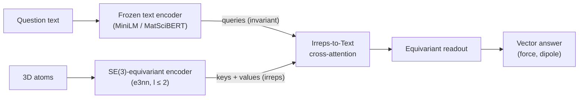

<p>
  <a href="https://antigravity.google/"></a>
  <sub>This project uses API credits from the Google Antigravity for Science program. Thank you, Google Antigravity!</sub>
</p>
<br clear="left">

<div align="center">
<picture>
  <source media="(prefers-color-scheme: dark)" srcset="assets/YLM_mark_dark.svg">
  
</picture>

# YLM

**Ask a question in words, get a 3D vector back that rotates exactly with the molecule.**

[](LICENSE)
[](environment.yml)
[](https://github.com/yaniguan/YLM/actions/workflows/tests.yml)

</div>

## What it does

YLM (Y_lm + Language Model) lets text tokens attend directly to rotation-equivariant 3D features. Ask *"What is the force on the oxygen atom bonded to two carbons?"* and the model picks the atom from the words and returns a force vector. Rotate the molecule and the answer rotates with it, exactly, by construction.

## Quickstart

```bash
git clone https://github.com/yaniguan/YLM.git && cd YLM
pip install torch "e3nn==0.4.4" numpy transformers
```

Run from the repo root (the v0 checkpoints are in `checkpoints/v0/`; the text encoder downloads from Hugging Face):

```python
import torch
from src.model import YLM          # import before e3nn (sets up its loader)
from src.inference import predict_vector
from e3nn import o3
from transformers import AutoModel, AutoTokenizer

ck = torch.load("checkpoints/v0/ylm_minilm_s0.pt", map_location="cpu", weights_only=False)  # trusted repo file
name = "sentence-transformers/all-MiniLM-L6-v2"
tok, lm = AutoTokenizer.from_pretrained(name), AutoModel.from_pretrained(name).eval()

def encode(q):  # frozen text encoder -> token states (T, d)
    with torch.no_grad():
        return lm(**tok(q, return_tensors="pt")).last_hidden_state[0]

model = YLM(text_dim=lm.config.hidden_size, text_mode="text", option="A")
model.load_state_dict(ck["state_dict"])
force_scale = torch.tensor(ck["scale"])[1]

Z = [8, 1, 1]                                   # water
pos = torch.tensor([[0.0, 0.0, 0.0], [1.81, 0.0, 0.0], [-0.45, 1.75, 0.0]])  # bohr
q = "What is the force on the oxygen atom?"

f = predict_vector(model, Z, pos, q, encode, task=1) * force_scale
R = o3.rand_matrix()
f_rot = predict_vector(model, Z, pos @ R.T, q, encode, task=1) * force_scale
print("force (hartree/bohr):", f.tolist())
print("rotation error:", ((f_rot - R @ f).norm() / f.norm()).item())
```

```text
force (hartree/bohr): [-0.0102, -0.0132, 0.0]
rotation error: 1.2e-06
```

`task=0` asks for the molecular dipole instead. To evaluate on the full benchmark, build the data (QM9 + GFN2-xTB, steps 1–3 in [docs below](#reproduce)) and run `python scripts/09_eval_checkpoint.py --ckpt checkpoints/v0/ylm_matscibert_s0.pt --demo`.

## Key features

- **Irreps-to-Text cross-attention.** Text queries l ≥ 1 irreps directly. Attention weights use only invariants, so the output is exactly SE(3)-equivariant.
- **Three attention options.** A: invariant weights × equivariant values. B: direction-aware keys. C: text-weighted Clebsch-Gordan products.
- **TensorQA-v0 benchmark.** 84,757 dipole and force questions on 20k QM9 molecules, with held-out wordings ([data card](DATA_CARD.md)).
- **Rotation protocol.** Every test question is scored under 32 random rotations.
- **Small, shipped checkpoints.** 1–2 MB each in [`checkpoints/v0/`](checkpoints/v0/README.md), with a frozen MiniLM or MatSciBERT text encoder.

## Results

TensorQA-v0 test set, force questions (hartree/bohr).

| Result | Value | Source |
|---|---|---|
| Force cosine, YLM + MatSciBERT (5 seeds) | **0.960 ± 0.004** | [`results.md`](results.md) (made by `scripts/07_make_table.py`) |
| Force cosine, task ID instead of question text (4 seeds) | 0.113 ± 0.004 | [`results.md`](results.md) |
| Force MAE, YLM + MatSciBERT vs task ID | 0.0064 vs 0.0424 (6.6× lower) | [`results.md`](results.md) |
| Mean rotation (equivariance) error | **~2e-6** (float32 round-off) | [`checkpoints/v0/results.json`](checkpoints/v0/results.json) (`eq_err_mean`) |
| Force MAE, Option C (seed 0, MiniLM) | 0.00487 (cos 0.976) | [`docs/results_options_abc.md`](docs/results_options_abc.md) |
| Force cosine on held-out wordings, MatSciBERT | 0.917 ± 0.021 | [`results.md`](results.md) |

Without the question text the model cannot tell which atom is asked about, so the force direction is near random. With the text it is right. The worst-case rotation error (`eq_err` in `results.md`) reaches ~1e-3 on near-zero predictions.

## How it works



One rule: attention weights use only invariant numbers; anything with a direction is only scaled by invariants or combined through Clebsch-Gordan products. Rotating the input by R then rotates the output by R. Design details: [`03_technical_design.md`](03_technical_design.md).

## Repo layout

```
src/          encoder, Irreps-to-Text attention (A/B/C), model, inference helper
scripts/      01 labels → 02 questions → 03 text features → 04 train → 07 table → 09 eval checkpoint
checkpoints/  v0 checkpoints + results.json
tests/        equivariance tests
analysis/     sample-efficiency plot, error breakdown
docs/         experiment notes, Option A/B/C results
colab/        GPU notebooks
00–06_*.md    glossary, related work, novelty check, design, benchmark, risks, plan
```

<a id="reproduce"></a>Reproduce from scratch: `conda env create -f environment.yml`, download QM9, then run `scripts/01`–`04` and `07` (see [`progress.md`](progress.md) and the script headers). The packaged benchmark `tensorqa_v0.tar.gz` is on the [v0.1.0 release](https://github.com/yaniguan/YLM/releases/tag/v0.1.0).

## Limitations / status

- **v0.** Labels are GFN2-xTB (semi-empirical), not DFT. Questions come from 12 templates (4 held out).
- Only vectors (l = 1) are asked, although the encoder carries l = 2.
- **A rule parser + equivariant force model matches or beats YLM** on v0 questions (force MAE 0.0057 vs 0.0064, [`results_baselines.md`](results_baselines.md)); harder compositional questions are needed.
- The Qwen2.5-0.5B coordinates-as-text baseline did not learn the force, so it is not evidence that an end-to-end LLM cannot.
- The text encoder is frozen and the model does not generate text yet. Attention often lands on a bonded neighbour, not the exact atom.

## Optional routing report

Add `--routing_audit` to `scripts/04_train.py` to save a `routing` report for
held-out evaluation. It measures invariant and directional score spread, attention
entropy, target attention and rank, and top-k accuracy. It also counts correct,
nearby, and far atom choices. Each force question is counted once, without rotating
the molecule. Nearby means less than 3.4 bohr apart; it does not mean bonded.
The report is off by default.

## Optional normalized scores

To use normalized scores for Option B, pass `--b_score_mode normalized` to
`scripts/04_train.py`, or set `YLMConfig(b_score_mode="normalized")` for the LM adapter.
This mode normalizes the query and key vectors in each channel before taking their
dot product. It divides the result by the square root of the channel count and
multiplies it by a learned weight passed through `tanh`. The weight starts at zero.
The default is `legacy`, which keeps the original scores and checkpoint format.
The tests do not show whether this improves how text selects atoms.

## Citation

Not published yet. Placeholder:

```bibtex
@misc{ylm2026,
  title  = {YLM: Irreps-to-Text Cross-Attention for Equivariant Language-Geometry Alignment},
  author = {Guan, Yani},
  year   = {2026},
  note   = {Work in progress}
}
```

## License

- Code: [MIT](LICENSE)
- Data and benchmark (TensorQA): [CC BY 4.0](https://creativecommons.org/licenses/by/4.0/)
