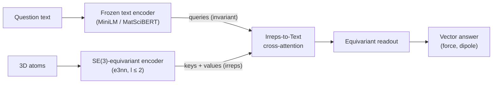

<p>
  <a href="https://antigravity.google/"></a>
  <sub>This project uses API credits from the Google Antigravity for Science program. Thank you, Google Antigravity!</sub>
</p>
<br clear="left">

<div align="center">
<picture>
  <source media="(prefers-color-scheme: dark)" srcset="assets/YLM_mark_dark.svg">
  
</picture>

# YLM

**Ask a question in words, get a 3D vector back that rotates exactly with the molecule.**

[](LICENSE)
[](environment.yml)
[](https://github.com/yaniguan/YLM/actions/workflows/tests.yml)

</div>

## What it does

YLM (Y_lm + Language Model) lets text tokens attend directly to rotation-equivariant 3D features. Ask *"What is the force on the oxygen atom bonded to two carbons?"* and the model picks the atom from the words and returns a force vector. Rotate the molecule and the answer rotates with it, exactly, by construction.

## Quickstart

```bash
git clone https://github.com/yaniguan/YLM.git && cd YLM
pip install torch "e3nn==0.4.4" numpy transformers
```

Run from the repo root (the v0 checkpoints are in `checkpoints/v0/`; the text encoder downloads from Hugging Face):

```python
import torch
from src.model import YLM          # import before e3nn (sets up its loader)
from src.inference import predict_vector
from e3nn import o3
from transformers import AutoModel, AutoTokenizer

ck = torch.load("checkpoints/v0/ylm_minilm_s0.pt", map_location="cpu", weights_only=False)  # trusted repo file
name = "sentence-transformers/all-MiniLM-L6-v2"
tok, lm = AutoTokenizer.from_pretrained(name), AutoModel.from_pretrained(name).eval()

def encode(q):  # frozen text encoder -> token states (T, d)
    with torch.no_grad():
        return lm(**tok(q, return_tensors="pt")).last_hidden_state[0]

model = YLM(text_dim=lm.config.hidden_size, text_mode="text", option="A")
model.load_state_dict(ck["state_dict"])
force_scale = torch.tensor(ck["scale"])[1]

Z = [8, 1, 1]                                   # water
pos = torch.tensor([[0.0, 0.0, 0.0], [1.81, 0.0, 0.0], [-0.45, 1.75, 0.0]])  # bohr
q = "What is the force on the oxygen atom?"

f = predict_vector(model, Z, pos, q, encode, task=1) * force_scale
R = o3.rand_matrix()
f_rot = predict_vector(model, Z, pos @ R.T, q, encode, task=1) * force_scale
print("force (hartree/bohr):", f.tolist())
print("rotation error:", ((f_rot - R @ f).norm() / f.norm()).item())
```

```text
force (hartree/bohr): [-0.0102, -0.0132, 0.0]
rotation error: 1.2e-06
```

`task=0` asks for the molecular dipole instead. To evaluate on the full benchmark, build the data (QM9 + GFN2-xTB, steps 1–3 in [docs below](#reproduce)) and run `python scripts/09_eval_checkpoint.py --ckpt checkpoints/v0/ylm_matscibert_s0.pt --demo`.

## Key features

- **Irreps-to-Text cross-attention.** Text queries l ≥ 1 irreps directly. Attention weights use only invariants, so the output is exactly SE(3)-equivariant.
- **Three attention options.** A: invariant weights × equivariant values. B: direction-aware keys. C: text-weighted Clebsch-Gordan products.
- **TensorQA-v0 benchmark.** 84,757 dipole and force questions on 20k QM9 molecules, with held-out wordings ([data card](DATA_CARD.md)).
- **Rotation protocol.** Every test question is scored under 32 random rotations.
- **Small, shipped checkpoints.** 1–2 MB each in [`checkpoints/v0/`](checkpoints/v0/README.md), with a frozen MiniLM or MatSciBERT text encoder.

## Results

TensorQA-v0 test set, force questions (hartree/bohr).

| Result | Value | Source |
|---|---|---|
| Force cosine, YLM + MatSciBERT (5 seeds) | **0.960 ± 0.004** | [`results.md`](results.md) (made by `scripts/07_make_table.py`) |
| Force cosine, task ID instead of question text (4 seeds) | 0.113 ± 0.004 | [`results.md`](results.md) |
| Force MAE, YLM + MatSciBERT vs task ID | 0.0064 vs 0.0424 (6.6× lower) | [`results.md`](results.md) |
| Mean rotation (equivariance) error | **~2e-6** (float32 round-off) | [`checkpoints/v0/results.json`](checkpoints/v0/results.json) (`eq_err_mean`) |
| Force MAE, Option C (seed 0, MiniLM) | 0.00487 (cos 0.976) | [`docs/results_options_abc.md`](docs/results_options_abc.md) |
| Force cosine on held-out wordings, MatSciBERT | 0.917 ± 0.021 | [`results.md`](results.md) |

Without the question text the model cannot tell which atom is asked about, so the force direction is near random. With the text it is right. The worst-case rotation error (`eq_err` in `results.md`) reaches ~1e-3 on near-zero predictions.

## How it works



One rule: attention weights use only invariant numbers; anything with a direction is only scaled by invariants or combined through Clebsch-Gordan products. Rotating the input by R then rotates the output by R. Design details: [`03_technical_design.md`](03_technical_design.md).

## Repo layout

```
src/          encoder, Irreps-to-Text attention (A/B/C), model, inference helper
scripts/      01 labels → 02 questions → 03 text features → 04 train → 07 table → 09 eval checkpoint
checkpoints/  v0 checkpoints + results.json
tests/        equivariance tests
analysis/     sample-efficiency plot, error breakdown
docs/         experiment notes, Option A/B/C results
colab/        GPU notebooks
00–06_*.md    glossary, related work, novelty check, design, benchmark, risks, plan
```

<a id="reproduce"></a>Reproduce from scratch: `conda env create -f environment.yml`, download QM9, then run `scripts/01`–`04` and `07` (see [`progress.md`](progress.md) and the script headers). The packaged benchmark `tensorqa_v0.tar.gz` is on the [v0.1.0 release](https://github.com/yaniguan/YLM/releases/tag/v0.1.0).

## Limitations / status

- **v0.** Labels are GFN2-xTB (semi-empirical), not DFT. Questions come from 12 templates (4 held out).
- Only vectors (l = 1) are asked, although the encoder carries l = 2.
- **A rule parser + equivariant force model matches or beats YLM** on v0 questions (force MAE 0.0057 vs 0.0064, [`results_baselines.md`](results_baselines.md)); harder compositional questions are needed.
- The Qwen2.5-0.5B coordinates-as-text baseline did not learn the force, so it is not evidence that an end-to-end LLM cannot.
- The text encoder is frozen and the model does not generate text yet. Attention often lands on a bonded neighbour, not the exact atom.

## Optional equivariant baselines

Pass `--model equillm` or `--model frame_avg` to `scripts/04_train.py` to run two
additional symmetry-preserving baselines from [`src/baselines.py`](src/baselines.py):
- `equillm`: uses the same `Encoder`, feeds only O(3) invariants and text tokens into a
  Transformer, and scales bypassed `1o` atom vectors afterwards.
- `frame_avg`: projects centered coordinates onto all 8 sign choices of the covariance
  eigenvectors, runs a plain Transformer in each canonical frame, and averages the 3D
  predictions back in the lab frame (exact O(3) equivariance when principal eigenvalues
  are distinct).

## Optional routing report

Add `--routing_audit` to `scripts/04_train.py` to save a `routing` report for
held-out evaluation. It measures invariant and directional score spread, attention
entropy, target attention and rank, and top-k accuracy. It also counts correct,
nearby, and far atom choices. Each force question is counted once, without rotating
the molecule. Nearby means less than 3.4 bohr apart; it does not mean bonded.
The report is off by default.

## Optional multi-layer cross-attention

Pass `--n_cross_layers K` (`K >= 2`) to `scripts/04_train.py`, or `YLM(..., n_cross_layers=K)`,
to stack `K` interactive two-stream blocks from `03_technical_design.md`. After each
cross-attention step, O(3) invariants of the equivariant side stream `e_t` feed back
into the text stream `h_t` alongside masked token self-attention before the next
`IrrepsToText` query and equivariant residual mix. The default `n_cross_layers=1`
keeps the original architecture and v0 checkpoint format.

## Optional normalized scores

To use normalized scores for Option B, pass `--b_score_mode normalized` to
`scripts/04_train.py`, or set `YLMConfig(b_score_mode="normalized")` for the LM adapter.
This mode normalizes the query and key vectors in each channel before taking their
dot product. It divides the result by the square root of the channel count and
multiplies it by a learned weight passed through `tanh`. The weight starts at zero.
The default is `legacy`, which keeps the original scores and checkpoint format.
The tests do not show whether this improves how text selects atoms.

## Optional channel-wise Option C

Pass `--c_tp_mode channelwise` to `scripts/04_train.py` or `scripts/20_pretrain_lm.py`,
or set `YLMConfig(c_tp_mode="channelwise")`, to replace Option C's fully connected
Clebsch-Gordan self-product with a channel-wise (`uvu`) tensor product followed by an
`o3.Linear` channel mix. This preserves all compatible angular paths (including
`1o x 1o -> 2e` and `1o x 1o -> 1e`) and exact O(3) equivariance while cutting the
per-token CG weight count from cubic to quadratic in channel multiplicity (reducing
default Option C parameters from ~13.1M to ~0.85M and lowering `SliceBackward0`
memory traffic). The default remains `fully_connected` for checkpoint compatibility.

## Optional invariant targets

QM9 LM pretraining accepts `--target_mode invariant` in `scripts/20_pretrain_lm.py`.
This mode predicts energy and dipole magnitude, without the x, y, and z dipole
components. Use the same mode for all runs you compare: it changes the prediction
task and the tokens used in training. The default is `cartesian`. The mode is
saved in the run config and must match when you resume. Older configs use
`cartesian`.

## Optional `<vec>` equivariant readout for `YLMCausalLM`

Set `YLMConfig(mode="xattnA"|"xattnB"|"xattnC", vec_readout=True, vec_token_id=tok.vec_id)`
to attach an O(3)-equivariant `1x1o` vector head to the adapter's equivariant side
stream `e_t`, gated by final-layer invariant LM states. Text `logits` remain strictly
O(3)-invariant while `out["vec"]` at `<vec>` positions rotates and reflects exactly
with the input geometry. Passing `vec_targets` adds vector MSE (`vec_loss_weight`) to
the causal LM token loss, and `decode_with_vectors` emits both decoded text and 3D
vectors at generated `<vec>` tokens. Defaults keep `vec_readout=False`.

## Geometry control runs

Downstream evaluation accepts `--geometry_control zero` or `donor`. The default,
`original`, leaves coordinates unchanged. These options change only test
coordinates; training and validation stay the same. Donor coordinates come from
training rows with matching elements and atom roles in each species. All other
row data stays the same. `results.json` records how many rows changed and how many
had no matching donor. SMILES-only runs stay the same. Zero coordinates differ
from the training data, and some rows may have no donor. These checks show how
results depend on coordinates, but do not prove cause and effect.

## Optional group exposure guard

Use `--group_exposure_guard` in post-training and downstream evaluation to
record training groups and check for overlap with validation and test groups.
It is off by default. CALiSol uses formulation groups. RedDB uses canonical
reactants and scaffolds, including the empty scaffold for molecules without rings.
Saved groups are combined across SFT and DPO stages. The guard rejects tasks
whose earlier training groups are unknown; it cannot recover groups from row IDs.

## Optional joint training

Use `--multitarget` in downstream evaluation to train RedDB/MP targets together
with one language model and output head per task and seed. Missing labels do not
affect training. Each target is scaled using its training labels, and the loss
is the average of the targets' mean squared errors. Validation picks the best
model and head to restore. Results under `finetune_joint` include test rows and
metrics for each target. By default, targets are still trained separately.
Training targets together can hurt some targets' results.

## Optional composition baseline

Add `--mp_composition_baseline` to downstream evaluation to enable this baseline
(off by default). It uses the fraction of each of the 118 elements in the full
charged structure and a separate column for each working ion, including unknown
ions. Fractions are computed before cutting the crystal to a cluster. Reordering
sites or repeating the cell does not change them. Ridge regression fits scaling
on training rows and chooses its penalty on validation rows. Results appear as
`composition/ridge`. Inputs exclude atom positions and electrochemical targets.

## Optional tensor readout

`YLM(..., tensor_readout=True)` adds a `0e+2e` head and returns one symmetric
3x3 matrix. The default model still returns one vector, and the v0 checkpoints
still load. Quadrupole matrices from `scripts/12_make_quadrupole.py` can be
trained with `scripts/16_train_quad.py`. That script stays unused unless you run it.

## Optional periodic crystal graph and packaging

`Encoder.forward` and `YLMCausalLM` accept optional periodic lattice vectors
`cell` (`(B, 3, 3)` rows in bohr) and `pbc` (`(B, 3)` boolean mask) to construct
minimum-image / multi-image neighbor graphs across periodic boundaries, including
periodic self-images (`i == j` at non-zero lattice shifts) in small unit cells.
When `cell` is omitted, the molecular pair graph is unchanged. For Materials
Project insertion electrodes in `scripts/22_downstream_eval.py`, pass
`--mp_geom_mode pbc` to encode unit cells with 3D periodic boundary conditions
instead of cutting a finite 6 Å cluster (`--mp_geom_mode cluster`, default). The
repository can also be installed as an editable Python package with
`pip install -e .`.

## Command-line tools and browser Studio (`ylm`)

Install the repo in editable mode (`pip install -e .`) to get the `ylm` command,
the `src.toolkit` Python helpers, 3D HTML reports, and the local browser Studio
(`ylm serve`). Design notes and paper tables are in
[`specs/001-ylm-probe-toolkit/`](specs/001-ylm-probe-toolkit/spec.md).

```bash
# Ask a question on a molecule, check 3D rotation + mirror rules, and save a 3D HTML report
ylm ask examples/water.xyz "What is the force vector on the oxygen atom?" --verify-o3 --html water_probe.html

# Topic tools: battery solvation shells, reactive MD trajectories, and drug pockets
ylm solvation examples/li_ec_shell.xyz --verify-o3 --html solvation.html
ylm scan-traj examples/proton_transfer_traj.extxyz --verify-o3 --html md_traj.html
ylm drug examples/indole_pocket.xyz --verify-o3 --html drug_lead_opt.html

# Fine-tune a small language model with <vec> 3D vector output
ylm posttrain --input examples/proton_transfer_traj.extxyz --out runs/demo_lm --steps 20 --dpo-steps 4 --freeze-lm

# Check all 8 physics rules (64-bit) or open the 5-tab browser Studio
ylm audit-physics r_fec_chiral --precision float64 --rotations 8
ylm serve --port 8765
ylm export-hf --labels data/qm9_xtb.pkl --v0 data/tensorqa_v0.json --out dist/hf_tensorqa --anonymized
```

## Optional MACE / NequIP backbones, MD monitor, and Ouroboros bridge

- **MACE and NequIP / Allegro backbones**: `src/mace_backbone.py` (`MACEEncoder`) and `src/nequip_backbone.py` (`NequIPEncoder`) plug pretrained MACE-MP-0, MACE-OFF23, or TorchScript NequIP/Allegro `.pth` models into `YLM` (`--mace` / `--nequip`), keeping exact 3D forces (`F = -dE/dx`) and crystal repeat boxes.
- **Live MD reaction monitor**: `src/toolkit/mlip_md.py` (`ylm run-md`) and `src/toolkit/md_hooks.py` (`OpenMMReactionReporter`, `LAMMPSReactionHook`) watch simulations step by step and log when bonds form, break, or transfer a proton (`H+`), saving SVG timelines and 3D HTML animations (`python scripts/33_demo_live_md_hooks.py`).
- **Ouroboros 2D-to-3D stereo bridge**: `src/toolkit/ouroboros_bridge.py` (`ylm from-ouroboros`, `python scripts/34_ouroboros_to_ylm.py`) reads 2D drawings, stereo SMILES (`@/@@`, `/\`), `predictions.csv`, or `.extxyz` files from `yaniguan/ouroboros-ocsr` and checks 3D left/right handedness (`R`/`S`) and `cis`/`trans` double bonds.

## Multi-task 3D model (`YLMUniverseModel`) and Uni-Mol comparison

`src/universe_fm.py` (`YLMUniverseModel`) predicts four types of outputs from one shared model:
plain numbers (energy, gap), left/right handedness (`out["chiral"]`, which flips sign in a mirror and equals `0` on flat molecules), 3D arrows (dipole and atom forces), and symmetric 3x3 matrices (polarizability, quadrupole, stress). `src/fm_baselines.py` compares it against `UniMolStyle3DBaseline`, `GraphMVP3DInfoMaxBaseline`, and `EquiLLMMultiTaskBaseline`:

```bash
python scripts/31_prepare_universe_data.py --smoke --out data/universe_smoke
python scripts/30_train_universe_fm.py --name universe_smoke --data_dir data/universe_smoke --tiny --epochs 20 --device cpu
python scripts/32_benchmark_vs_unimol.py --data_dir data/universe_smoke --tiny --epochs 20 --device cpu
python scripts/35_build_and_eval_chiral_benchmark.py --tiny --epochs 24 --out_dir runs/chiral_universe_benchmark
```

## Citation

Not published yet. Placeholder:

```bibtex
@misc{ylm2026,
  title  = {YLM: Irreps-to-Text Cross-Attention for Equivariant Language-Geometry Alignment},
  author = {Guan, Yani},
  year   = {2026},
  note   = {Work in progress}
}
```

## License

- Code: [MIT](LICENSE)
- Data and benchmark (TensorQA): [CC BY 4.0](https://creativecommons.org/licenses/by/4.0/)
