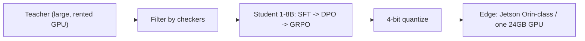

# YLM lab-scale plan

Status: plan. Nothing in the Plan section has been run. Planned numbers are TBD.

## Role in the lab agent

YLM is the "brain". It reads a protocol, knows which molecules each step touches, and answers: is this step right, why did it fail, what should come next. It works with two other parts: [ouroboros-ocsr](https://github.com/yaniguan/ouroboros-ocsr) (the "eyes": images to SMILES) and [WignerFlow](https://github.com/yaniguan/WignerFlow) (the "physics sense": a fast MD surrogate). The eval harness and RL environments come from [labbench-posttrain](https://github.com/yaniguan/labbench-posttrain). The big model is distilled into a small one that runs next to the robot.

Analogy: today's lab robot is an athlete who only drills dunks; YLM adds the physics and nutrition science so new plays can emerge.

How the parts connect (one prompt per protocol step):

| from | what | to | code |
|---|---|---|---|
| ouroboros-ocsr | context JSONL (`ouroboros.molecule_context/v1`); only `status=ok` rows | molecule block | [lab/molecule_context.py](../lab/molecule_context.py) `read_context_jsonl` |
| WignerFlow | `[physics]` lines from a JSON query (argon only today; else "unsupported") | physics block | [lab/protocol_qa.py](../lab/protocol_qa.py) `build_prompt(..., physics_lines)` |
| YLM | answer, step fix, or new plan | robot / human | TBD |

New plans: GRPO rewards any plan that passes the checkers, not only plans that copy a human one. Whether this finds useful new plans is untested.

## What exists today

| fact | file |
|---|---|
| Text attends to rotation-equivariant 3D features (Irreps-to-Text, Options A/B/C) | [src/irreps_to_text.py](../src/irreps_to_text.py), [src/model.py](../src/model.py) |
| TensorQA-v0 force cosine 0.960 ± 0.004 (MatSciBERT, 5 seeds); 0.113 ± 0.004 with task ID only | [results.md](../results.md) |
| Mean rotation error ~2e-6 (float32) | [checkpoints/v0/results.json](../checkpoints/v0/results.json) |
| Small LM + IrrepsAdapter with a `<vec>` vector head | [src/ylm_lm.py](../src/ylm_lm.py) |
| SFT and DPO post-training for `<vec>` answers (`ylm posttrain`) | [src/toolkit/posttrain.py](../src/toolkit/posttrain.py), [src/tasks/sft.py](../src/tasks/sft.py) |
| Bridge from ouroboros-ocsr output to 3D frames (keeps R/S and cis/trans) | [src/toolkit/ouroboros_bridge.py](../src/toolkit/ouroboros_bridge.py) |
| New: protocol-QA scorer, OCSR context reader, `[physics]` prompt lines, distill dry run | [lab/](../lab/README.md) |

Limits today (from [README.md](../README.md)):
- Labels are GFN2-xTB, not DFT. Questions come from templates.
- A rule parser + equivariant force model matches or beats YLM on v0 ([results_baselines.md](../results_baselines.md)).
- YLM has no protocol-text reasoning yet. No GRPO in this repo (it lives in labbench-posttrain).

## Lab tasks it serves

| task | input | output | benchmark |
|---|---|---|---|
| Protocol QA | protocol + question | choice / short answer | LAB-Bench ProtocolQA; BioProBench protocol QA |
| Step debugging | protocol + bad outcome | the step to fix and the fix | LAB-Bench ProtocolQA; BioProBench error correction |
| Step ordering | shuffled steps | correct order | BioProBench step ordering |
| Workflow generation | goal + materials | step list | BioProBench protocol generation; BioProt |
| Experiment design | goal + constraints | plan with steps | LAB-Bench CloningScenarios; BioProt |
| Molecule check | SMILES / 3D structure + question | fact (chirality, dipole, force) | TensorQA-v0 (this repo) |

Benchmarks: LAB-Bench (arXiv 2407.10362, HF `futurehouse/lab-bench`), BioProBench (arXiv 2505.07889, HF `BioProBench/BioProBench`), BioProt (arXiv 2310.10632, github.com/bioplanner/bioplanner). LAB-Bench is eval only.

## Plan

| | goal | data | method | metric | done when |
|---|---|---|---|---|---|
| M1 | Baseline: how well do open models do today? | LAB-Bench ProtocolQA, CloningScenarios, SeqQA; BioProBench test | Run candidate teachers and small students through labbench-posttrain `labeval/` | accuracy, coverage, precision (TBD) | Baseline table checked in with seeds and model names |
| M2 | Molecule-aware prompts | BioProBench items with chemicals; OCSR context JSONL | Add molecule block ([lab/molecule_context.py](../lab/molecule_context.py)); optional YLM probe for 3D facts; `[physics]` lines only where WignerFlow supports the system | paired accuracy, with vs without block (TBD) | Paired result on the same items, both arms reported |
| M3 | Distill teacher to student | Teacher answers that pass BioProBench checkers | SFT -> DPO -> GRPO with labbench-posttrain `posttrain/` | student vs teacher on held-out split (TBD) | 1-8B student checkpoint + eval report |
| M4 | Edge build | Same eval set as M3 | 4-bit quantization; run on target box | accuracy drop vs fp16, latency, memory (TBD) | Student runs offline on a Jetson Orin-class box or one 24GB GPU |

Recipe: SFT -> DPO -> GRPO.

## Distillation and edge path

| stage | size target | hardware |
|---|---|---|
| Teacher | large open-weight model (TBD) | rented A100/H100 bursts |
| Student | ~1-8B (smaller if accuracy holds) | rented A100/H100 for training |
| Edge | student at 4-bit | Jetson Orin Nano Super / AGX Orin, or one 24GB GPU (L4 / RTX 4090) |
| Molecule head | YLM v0 checkpoints, 1.0-1.8 MB each + a frozen text encoder ([checkpoints/v0/README.md](../checkpoints/v0/README.md)) | CPU (Quickstart in README loads on CPU) |

Plan check: `python -m lab.distill --dry-run` (config: [lab/configs/distill_protocol.json](../lab/configs/distill_protocol.json)).

## Cost

Rent first, do not buy a GPU box yet. Prices, buy-vs-rent math and monthly budget: [docs/lab_cost_setup.md](lab_cost_setup.md) (shared doc, also at https://github.com/yaniguan/YLM/blob/main/docs/lab_cost_setup.md). All prices are estimates.

Single-GPU saturation: how to keep one rented H200/B200 busy (colocated GRPO, memory sizing, MFU targets): [docs/single_gpu_saturation.md](single_gpu_saturation.md).

## Risks

- **License:** BioProBench is CC-BY-NC-4.0 (non-commercial). Fine for research; a product needs our own protocol data. LAB-Bench is CC-BY-SA-4.0 and eval only. BioProt license: check before use.
- **Contamination:** teachers may have seen LAB-Bench. Use labbench-posttrain contamination checks; keep a private held-out set.
- **Small-student gap:** a 1-8B student may lose too much reasoning. M3 must report the gap honestly.
- **Molecule value unproven:** the molecule block may not help protocol QA. M2 is a paired test, and we keep it only if it helps.
- **OCSR errors:** a wrong SMILES misleads the brain. Low-confidence structures are flagged, not hidden.

## Next steps

Each item matches one GitHub issue:
1. Run M1 baselines through labbench-posttrain and check in the table.
2. Wire the molecule block into protocol prompts and run the paired M2 test.
3. Build the distill data (teacher answers filtered by checkers) and run SFT -> DPO -> GRPO.
4. Quantize the student to 4-bit and benchmark on an edge-class box.
5. Start a commercial-safe protocol dataset to replace BioProBench for product use.
