# Bridging SE(2)-Equivariant 2D OCSR, 3D Stereochemistry/Chirality, and Universal O(3)-Equivariant MLIPs to Tensor-Valued Foundation Models (Ouroboros-OCSR × YLM): Literature Survey & Symmetry Synthesis (2016–2025)

> **Scope & Verification Note**: This report compiles and bibliographically verifies **38 peer-reviewed papers and landmark preprints (2016–2025)** across *Nature Communications*, *Journal of the American Chemical Society (JACS)*, *Physical Review Letters (PRL)*, *Chemical Science*, *Journal of Chemical Theory and Computation (JCTC)*, *The Journal of Physical Chemistry B (JPCB)*, *The Journal of Chemical Physics (JCP)*, *Journal of Chemical Information and Modeling (JCIM)*, *Journal of Cheminformatics*, *ICML*, *NeurIPS*, *ICLR*, *CVPR*, *ICCV*, and *MICCAI*, organized into four tightly coupled thematic clusters:
> - **Cluster A (No. 1–10)**: Optical Chemical Structure Recognition (OCSR) & Stereo-Preserving 2D-to-Graph Extraction
> - **Cluster B (No. 11–19)**: $SE(2)$ & Steerable Group-Equivariant Vision for Planar Diagrams
> - **Cluster C (No. 20–28)**: 3D Chirality, Pseudoscalars (`0o`), & Stereoisomer-Aware Conformer Generation
> - **Cluster D (No. 29–38)**: $O(3)$-Equivariant MLIPs & Reactive MD Tooling Ecosystem (`NequIP`, `Allegro`, `MACE`, `OpenMM`)

---

## 0. Core Architectural Insight: The Four-Stage Symmetry Fracture Between 2D Chemical Literature and 3D Tensor Physics

Modern AI for chemistry suffers from a profound **group-theoretic disconnect** across perception, 3D embedding, interatomic potentials, and language-conditioned physical readout:

1. **Planar Symmetry vs. Wedge/Hash Stereochemistry Fracture in OCSR (Clusters A & B)**: Mainstream deep OCSR pipelines (`DECIMER.ai`, `SwinOCSR`, `MolScribe`, `MolGrapher`, `MolNexTR`) employ translation-equivariant CNNs or ViT/Swin backbones that lack intrinsic planar rotation equivariance, relying instead on brute-force rotational augmentation. Conversely, naive application of full 2D Euclidean equivariance $E(2) = \mathbb{R}^2 \rtimes O(2)$ (`flipRot2dOnR2`) to molecular depictions is **chemically catastrophic**: reflecting a 2D wedge/hash diagram across a line inverts Cahn–Ingold–Prelog (CIP) $(R) \leftrightarrow (S)$ stereocenters in the image plane without altering bond connectivity. Exact 2D chemical perception therefore requires restricting the steerable gauge group strictly to orientation-preserving planar proper rotations $SE(2) = \mathbb{R}^2 \rtimes SO(2)$ (realized discretely via $C_N$, e.g., $C_8$ in `Ouroboros-OCSR`).
2. **Pairwise-Distance (`0e`) Enantiomer & Vector Blindness in 3D Molecular Pretraining (Cluster C)**: Leading 3D molecular foundation models (`Uni-Mol`, `GraphMVP`, `3D-MoLM`, and radial-filter baselines descending from `SchNet`) represent 3D conformations solely via pairwise Euclidean distances $d_{ij} = \|\mathbf{r}_i - \mathbf{r}_j\|_2$. Because $d_{ij}(-\mathbf{r}) = d_{ij}(\mathbf{r})$ holds identically under spatial parity inversion $P = -I_3 \in O(3) \setminus SO(3)$, pairwise distance matrices live purely in the even-scalar trivial irrep (`0e`). They are mathematically **100% blind to 3D tetrahedral chirality** (incapable of distinguishing $(R)$ vs. $(S)$ enantiomers or generating odd pseudoscalars `0o`) and, by Schur's Lemma, **incapable of predicting covariant `1o` vectors or `2e` tensors** ($\operatorname{Hom}_{SO(3)}(\mathbf{0e}, \mathbf{1o}) = \{0\}$).
3. **Readout Collapse in Universal $O(3)$-Equivariant MLIPs (Cluster D)**: Universal machine-learning interatomic potentials (`NequIP`, `Allegro`, `MACE`, `MACE-MP-0`, `MACE-OFF23`, `SevenNet`, `EquiformerV2`, `eSEN`) construct rich internal high-order spherical tensors (`0e`, `0o`, `1o`, `1e`, `2e`, `3o`) via Clebsch–Gordan tensor products, yet contract all higher-rank channels at the readout head into a single parity-even total energy scalar $E \in \mathbf{0e}$ (plus conservative gradients $\mathbf{F}_i = -\nabla_{\mathbf{r}_i} E \in \mathbf{1o}$). Because potential energy $E$ is parity-even ($E(-\mathbf{r}) = E(\mathbf{r})$ under non-parity-violating electromagnetic Hamiltonians), energy errors alone can **never** detect a stereochemical inversion error propagated from 2D OCSR, nor can silent MLIPs answer language-addressed queries over atom-specific forces, chiral pseudoscalars (`0o`), quadrupoles/polarizabilities (`0e + 2e`), or live `OpenMM` reactive trajectories.

Pairing **`Ouroboros-OCSR`** ($SE(2)/C_8$ steerable visual recognition $\to$ stereo-enforced `ETKDGv3` + 3D CIP `stereo_ok` audit $\to$ `MACE-OFF23` `.extxyz` + `.manifest.jsonl`) with **`YLMUniverseModel`** (mounted on `e3nn`, `MACEEncoder`, or `NequIPEncoder`, exposing `0e` scalar + `0o` chiral pseudoscalar + `1o` vector + `0e+2e` symmetric tensor readouts via `IrrepsToText` and `OpenMM` MD hooks) closes this end-to-end 2D-image-to-3D-chiral-tensor loop without losing parity or directional covariance at any stage.

---

## 1. Evolution of the Four Thematic Literature Clusters

### 1.1 Cluster A: Optical Chemical Structure Recognition (OCSR) & Stereo-Preserving 2D-to-Graph Extraction (No. 1–10)
The OCSR literature evolved across three architectural generations:
- **Segmentation & Image-to-Sequence Captioning**: Following the systematic benchmark review of rule-based OCSR engines (`OSRA`, `Imago`, `MolVec`) by Rajan et al. (2020, No. 1), early deep models framed OCSR either as pixelwise semantic segmentation of atoms/bonds/charges (`ChemGrapher`, Oldenhof et al., 2020, No. 2) or end-to-end encoder–decoder captioning into SMILES/SELFIES/InChI (`Img2Mol`, Clevert et al., 2021, No. 3; `SwinOCSR`, Xu et al., 2022, No. 4; `DECIMER.ai`, Rajan et al., 2023, No. 7). While sequence decoders scale cleanly to millions of synthetic depictions, pure 1D string decoding lacks explicit geometric supervision over wedge/hash bond orientations and suffers sharp accuracy drops under arbitrary in-plane diagram rotations.
- **Hybrid Keypoint / Image-to-Graph & ConvNeXt-Transformer Parsers**: `MolScribe` (Qian et al., 2023, No. 5) and `MolGrapher` (Morin et al., 2023, No. 8) explicitly recover 2D atomic coordinates and bond topologies (including solid-wedge and hashed-wedge directional edges) to reconstruct stereochemically valid graphs via RDKit, while `MolNexTR` (Chen et al., 2024, No. 9) fuses ConvNeXt local stroke features with Vision Transformer global context to handle abbreviated functional groups and stereocenters.
- **Document-Level Reaction & Markush Generalization**: `RxnScribe` (Qian et al., 2023, No. 6) and `MarkushGrapher` (Morin et al., 2025, No. 10) extend structure recognition to multi-molecule reaction schemes and patent Markush scaffolds with R-group text tables. Crucially, **none** of No. 1–10 incorporate an intrinsic $SE(2)$-equivariant steerable backbone, and **none** couple stereoisomer-verified OCSR output directly into MLIP force-field `.extxyz` generation.

### 1.2 Cluster B: $SE(2)$ & Steerable Group-Equivariant Vision for Planar Diagrams (No. 11–19)
Group-equivariant planar vision provides the exact mathematical machinery needed to make 2D diagram encoders rotation-covariant without erasing chiral wedge/hash orientation:
- **Discrete Group Lifting & Vector Field Convolutions**: `G-CNNs` (Cohen & Welling, 2016, No. 11) lifted planar translations $\mathbb{Z}^2$ to discrete roto-translations $p4 \cong \mathbb{Z}^2 \rtimes C_4$ and $p4m \cong \mathbb{Z}^2 \rtimes D_4$ via regular-representation group convolutions. `RotEqNet` (Marcos et al., 2017, No. 14) and Bekkers et al. (2018, No. 15) demonstrated parameter-compact $SE(2)$ lifting and group-pooling pipelines on oriented line/vessel structures analogous to chemical bond strokes.
- **Continuous Circular Harmonics & Unified $E(2)/E(n)$ Steerable Bases**: `Steerable CNNs` (Cohen & Welling, 2017, No. 12) and `Harmonic Networks` (Worrall et al., 2017, No. 13) parameterized filters in circular harmonic bases $e^{im\theta}$ to achieve continuous $SO(2)$ equivariance. Weiler & Cesa (`e2cnn`, 2019, No. 16) and Cesa, Lang & Weiler (`escnn`, 2022, No. 19) unified all compact subgroups $G \le O(n)$ via generalized Wigner–Eckart kernel space solvers, complemented by continuous Lie-algebraic/MLP solvers (`LieConv` / `EMLP`, Finzi et al., 2020/2021, No. 17) and spherical-function nonlinearities (Poulenard & Guibas, 2021, No. 18). `Ouroboros-OCSR` directly operationalizes `escnn` (`gspaces.rot2dOnR2(N=8)`) with anti-aliased `BlurPool2x2` downsampling and $C_8$ `GroupPooling`, preserving 2D stereochemical handedness by excluding $O(2)$ reflections.

### 1.3 Cluster C: 3D Chirality, Pseudoscalars (`0o`), & Stereoisomer-Aware Conformer Generation (No. 20–28)
Bridging 2D isomeric graphs to 3D atomistic ML requires preserving stereochemistry during conformer generation and maintaining parity-odd channels in 3D representation learning:
- **Geometric Incompleteness & Parity Theory**: `Tensor Field Networks` (Thomas et al., 2018, No. 20) introduced spherical-harmonic $SO(3)$ convolutions, which `e3nn` extended to full $O(3) = SO(3) \times \{+1, -1\}$ parity-labeled irreps ($\ell p$, $p \in \{e, o\}$). Pozdnyakov et al. (*PRL* 2020; *MLST* 2022, No. 21) proved that low-body-order invariant descriptors and distance-based GNNs (`SchNet`, `Uni-Mol`, `GraphMVP`, No. 27) suffer fundamental structural and chiral degeneracies.
- **Chiral Message Passing vs. Stereoisomer-Enforced 3D Conformer Sampling**: `TetraDMPNN` (Pattanaik et al., 2020, No. 22) and `ChIRo` (Adams et al., 2022, No. 25) designed parity-sensitive tetrahedral aggregators and internal-rotor-invariant signed torsion encoders. On the conformer generation side, `ETKDGv3` (Wang et al., 2020, No. 23) combines distance-geometry chiral volume bounds with experimental ring/torsion preferences, whereas generative models evolved from local frame/torsion prediction (`GeoMol`, Ganea et al., 2021, No. 24) and hypertorus score diffusion (`Torsional Diffusion`, Jing et al., 2022, No. 26) to unconstrained 3D coordinate diffusion (`MCF`, Wang et al., 2024, No. 28)—the latter requiring explicit post-hoc 3D CIP stereochemical filtering if used downstream of OCSR.

### 1.4 Cluster D: $O(3)$-Equivariant MLIPs & Reactive MD Tooling Ecosystem (No. 29–38)
Universal equivariant force fields provide the physical backbone for both `Ouroboros-OCSR` dataset labeling and `YLMUniverseModel` geometric encoding:
- **Equivariant Message Passing & Local Many-Body Potentials**: `NequIP` (Batzner et al., 2022, No. 29) proved that $E(3)$-equivariant tensor-product GNNs with odd/even parity irreps achieve quantum-chemical accuracy at a fraction of invariant sample complexity. `Allegro` (Musaelian et al., 2023, No. 31) eliminated message passing in favor of strictly local edge-equivariant tensor products for massive multi-GPU MD scaling, while `MACE` (Batatia et al., 2022, No. 30) combined Atomic Cluster Expansion (ACE) higher-body-order equivariant bases with 2-hop message passing.
- **Universal Foundation Potentials & Hybrid ML/MM Simulation Engines**: Scaling across the periodic table and organic chemical space yielded `MACE-MP-0` (Batatia et al., 2023/2025, No. 32), `EquiformerV2` (Liao et al., 2024, No. 34), `SevenNet` (Park et al., 2024, No. 35), `MatterSim` (Yang et al., 2024, No. 36), `MACE-OFF23` (Kovács et al., 2025, No. 37), and `eSEN` (Fu et al., 2025, No. 38). Meanwhile, `OpenMM 8` (`OpenMM-Torch` & `OpenMM-ML`, Eastman et al., 2024, No. 33) standardized zero-copy PyTorch/TorchScript execution of MLIPs inside GPU molecular dynamics, directly enabling `YLM`'s `NequIPEncoder`, `MACEEncoder`, `TorchMLIPForceProvider`, and `OpenMMReactionReporter`.

---

## 2. Master 38-Paper Verified Literature Survey

### 2.1 Section 1 — Optical Chemical Structure Recognition (OCSR) & Stereo-Preserving 2D-to-Graph Extraction (No. 1–10)

| # | Paper | Venue/Year | Core Mechanism | Relevance to Ouroboros × YLM & MLIP Stack |
| :-: | :--- | :--- | :--- | :--- |
| 1 | **OCSR Tools Review**: *A review of optical chemical structure recognition tools* — Rajan, Brinkhaus, Zielesny & Steinbeck | *J. Cheminform.* 12, 60 (2020) | Comprehensive taxonomy and benchmark of rule-based (`OSRA`, `Imago`, `MolVec`) vs. early deep OCSR engines across noisy patent/literature scans. | Establishes the standardized USPTO/UOB/ACS evaluation splits and stereochemical failure modes targeted by `Ouroboros-OCSR` (`scripts/eval_predictions.py`). |
| 2 | **ChemGrapher**: *ChemGrapher: Optical Graph Recognition of Chemical Compounds by Deep Learning* — Oldenhof, Arany, Moreau & Simm | *JCIM* 60(10), 4506–4517 (2020) | Two-stage CNN pixelwise segmentation + candidate atom/bond/charge classification loop reconstructing explicit 2D molecular graphs. | Pioneers direct graph-level stereo bond (wedge/hash) classification over brittle heuristic vectorization, motivating explicit stereo audits before 3D embedding. |
| 3 | **Img2Mol**: *Img2Mol – accurate SMILES recognition from molecular graphical depictions* — Clevert, Le, Winter & Montanari | *Chem. Sci.* 12, 14174–14181 (2021) | Deep CNN visual encoder projecting 2D molecular depictions into pretrained CDDD continuous latent embeddings decoded into SMILES. | Demonstrates robustness to stylization noise via latent chemical priors, but drops spatial rotation equivariance and explicit 2D stereocenter localization. |
| 4 | **SwinOCSR**: *SwinOCSR: end-to-end optical chemical structure recognition using a Swin Transformer* — Xu, Li, Yang, Li & Li | *J. Cheminform.* 14, 41 (2022) | Shifted-window hierarchical Vision Transformer encoder coupled to a focal-loss Transformer decoder generating SELFIES/SMILES strings. | Strong baseline for upright synthetic depictions, yet window-grid partitioning breaks $SO(2)$ rotation equivariance without heavy $0^\circ\text{--}360^\circ$ data augmentation. |
| 5 | **MolScribe**: *MolScribe: Robust Molecular Structure Recognition with Image-to-Graph Generation* — Qian, Guo, Tu, Li, Coley & Barzilay | *JCIM* 63(7), 1925–1934 (2023) | Swin Transformer encoder + autoregressive atom-token/2D-coordinate predictor + graph bond/wedge classifier reconstructing CIP stereochemistry via RDKit. | Gold-standard hybrid image-to-graph architecture proving that preserving local 2D bond orientation is essential for accurate $(R)/(S)$ and $(E)/(Z)$ recovery. |
| 6 | **RxnScribe**: *RxnScribe: A Sequence Generation Model for Reaction Diagram Parsing* — Qian, Guo, Tu, Coley & Barzilay | *JCIM* 63(13), 4030–4041 (2023) | Pix2Seq-style autoregressive sequence generator jointly detecting reactant, reagent, arrow, condition, and product bounding boxes in multi-step reaction diagrams. | Connects literature reaction diagram extraction directly to downstream reactive transition-state & `OpenMM`/`MLIP` mechanistic trajectory probing in `YLM`. |
| 7 | **DECIMER.ai**: *DECIMER.ai: an open platform for automated optical chemical structure identification, segmentation and recognition in scientific publications* — Rajan, Brinkhaus, Agea, Zielesny & Steinbeck | *Nat. Commun.* 14, 5045 (2023) | End-to-end PDF page segmentation + EfficientNetV2/ViT-to-SELFIES/SMILES Transformer trained on >400M synthetic depictions with rotational/blur augmentations. | Exemplifies the pure data-augmentation paradigm (`Arm B` in `Ouroboros-OCSR`), contrasting with `Arm C`'s zero-augmentation analytical $C_8$ steerable prior. |
| 8 | **MolGrapher**: *MolGrapher: Graph-based Visual Recognition of Chemical Structures* — Morin, Danelljan, Agea, Nassar, Weber, Meijer, Staar & Yu | *ICCV* (2023), pp. 19552–19561 | ResNet keypoint detector locating candidate atoms followed by a Graph Neural Network classifying atom symbols, superatoms, and stereochemical bonds (`USPTO-30K`). | Shows GNN topological reasoning over spatial keypoints boosts patent superatom parsing, motivating `Ouroboros-OCSR`'s `--expand-aliases` (`Me`, `Boc`, `Ph`, etc.). |
| 9 | **MolNexTR**: *MolNexTR: a generalized deep learning model for molecular image recognition* — Chen, Leung, Huang, Sun, Chen & Gao | *J. Cheminform.* 16, 141 (2024) | Dual-stream ConvNeXt + Vision Transformer encoder with coordinate/bond prediction heads and rule-based stereochemical & functional-group abbreviation expansion. | Highlights complementary inductive biases between local convolutional strokes and global self-attention—mirrored in `Ouroboros-OCSR`'s `Arm A + Arm C` ensemble. |
| 10 | **MarkushGrapher**: *MarkushGrapher: Joint Visual and Textual Recognition of Markush Structures* — Morin, Weber, Nassar, Meijer, Van Gool, Li & Staar | *CVPR* (2025) | Multimodal vision-language architecture jointly aligning 2D Markush core scaffolds, variable attachment points, and patent R-group text definitions. | Defines the boundary between expandable deterministic chemical aliases and generic patent R-groups that `image_to_forcefield.py` explicitly rejects before 3D embedding. |

---

### 2.2 Section 2 — $SE(2)$ & Steerable Group-Equivariant Vision for Planar Diagrams (No. 11–19)

| # | Paper | Venue/Year | Core Mechanism | Relevance to Ouroboros × YLM & MLIP Stack |
| :-: | :--- | :--- | :--- | :--- |
| 11 | **G-CNNs**: *Group Equivariant Convolutional Networks* — Cohen & Welling | *ICML* (2016), PMLR 48, 2990–2999 | Lifts 2D image convolutions from $\mathbb{Z}^2$ to discrete semidirect product groups $p4$ ($\mathbb{Z}^2 \rtimes C_4$) and $p4m$ ($\mathbb{Z}^2 \rtimes D_4$) with group coset pooling. | Foundational group-lifting blueprint; crucially reveals the split between $p4$ (proper rotations, stereo-safe) and $p4m$ (reflections included, stereo-inverting). |
| 12 | **Steerable CNNs**: *Steerable CNNs* — Cohen & Welling | *ICLR* (2017) | Generalizes G-CNNs from regular representations to arbitrary induced fiber representations $\operatorname{Ind}_H^G \rho$ constrained by linear steerability equations. | Provides the fiber-bundle representation theory underlying both 2D `escnn` (`Ouroboros-OCSR`) and 3D `e3nn` (`YLMUniverseModel`) equivariant layers. |
| 13 | **Harmonic Networks**: *Harmonic Networks: Deep Translation and Rotation Equivariance* — Worrall, Garbin, Turmukhambetov & Brostow | *CVPR* (2017), pp. 5028–5037 | Replaces pixel-grid kernels with complex circular harmonics $W_m(r,\phi) = R(r)e^{im(\phi+\beta_m)}$ achieving continuous $360^\circ$ $SO(2)$ patch equivariance. | Direct 2D $SO(2)$ Fourier analogue of 3D spherical harmonics $Y_\ell^m(\hat{\mathbf{r}})$, explaining pixel-grid interpolation residuals at non-$90^\circ$ angles in `C8`/`C16`. |
| 14 | **RotEqNet**: *Rotation Equivariant Vector Field Networks* — Marcos, Volpi, Komodakis & Tuia | *ICCV* (2017), pp. 5048–5057 | Applies rotated filter banks and propagates 2D orientation vector fields (magnitude + dominant angle) to preserve directional stroke geometry compactly. | Demonstrates how oriented thin-line geometry (analogous to covalent bond lines and wedge tapers) benefits from explicit directional covariance at low parameter count. |
| 15 | **SE(2) G-CNNs**: *Roto-Translation Covariant Convolutional Networks for Medical Image Analysis* — Bekkers, Lafarge, Veta, Eppenhof, Pluim & Duits | *MICCAI* (2018), LNCS 11070, 440–448 | Three-stage $SE(2)$ lifting $\to$ roto-translation group convolution $\to$ orientation max-projection pipeline on unaligned curvilinear 2D images. | Architectural template directly mirrored in `Ouroboros-OCSR` `steerable.py`: $C_8$ regular-field ResBlocks + anti-aliased `BlurPool2x2` + `GroupPooling`. |
| 16 | **E2CNN**: *General E(2)-Equivariant Steerable CNNs* — Weiler & Cesa | *NeurIPS* 32 (2019), pp. 14334–14345 | Solves the complete kernel constraint space for arbitrary irreps of all subgroups $G \le O(2)$ ($SO(2), O(2), C_N, D_N$) and benchmarks equivariant ResNets. | Directly establishes why `Ouroboros-OCSR` selects `C8` regular representations (`rot2dOnR2`) with gated/pointwise `InnerBatchNorm` + `ReLU` fiber nonlinearities. |
| 17 | **LieConv & EMLP**: *Generalizing Convolutional Neural Networks for Equivariance to Lie Groups on Arbitrary Continuous Data* — Finzi, Stanton, Izmailov & Wilson (with Finzi, Welling & Wilson, `EMLP`, *ICML* 2021) | *ICML* (2020), PMLR 119, 3165–3176 | Parameterizes continuous-coordinate convolutions over Lie algebra logarithm maps (`LieConv`) and solves arbitrary matrix-group equivariant bases (`EMLP`). | Clarifies off-grid continuous $SE(2)/SE(3)$ equivariance vs. discrete pixel-grid aliasing, motivating `Ouroboros-OCSR`'s pairwise-distance `RelDistMixer` token head. |
| 18 | **Functional Equivariant Non-Linearities**: *A Functional Approach to Rotation Equivariant Non-Linearities for Tensor Field Networks* — Poulenard & Guibas | *CVPR* (2021), pp. 13174–13183 | Treats steerable irrep channels as Fourier/spherical harmonic coefficients of functions on $S^1/S^2$, applying pointwise spatial activations via spherical grid sampling. | Bridges steerable activation design across 2D Fourier (`C_N` regular fields) and 3D `SO(3)/O(3)` spherical tensors (`eSCN`/`EquiformerV2`/`YLM` gated blocks). |
| 19 | **escnn**: *A Program to Build E(n)-Equivariant Steerable CNNs* — Cesa, Lang & Weiler | *ICLR* (2022) | Generalizes Wigner–Eckart theorem over real steerable bases (irreps, endomorphism rings, Clebsch–Gordan products) for arbitrary subgroups of $E(n)$ in PyTorch. | **Exact software backbone of `Ouroboros-OCSR` (`escnn.nn.R2Conv`)**, delivering $< 10^{-6}$ float32 feature equivariance error at $90^\circ/180^\circ$ rotations without augmentation. |

---

### 2.3 Section 3 — 3D Chirality, Pseudoscalars (`0o`), & Stereoisomer-Aware Conformer Generation (No. 20–28)

| # | Paper | Venue/Year | Core Mechanism | Relevance to Ouroboros × YLM & MLIP Stack |
| :-: | :--- | :--- | :--- | :--- |
| 20 | **Tensor Field Networks (TFN)**: *Tensor field networks: Rotation- and translation-equivariant neural networks for 3D point clouds* — Thomas, Smidt, Kearnes, Yang, Li, Kohlhoff & Riley | *arXiv:1802.08219* (2018) | Point-cloud convolutions combining radial MLPs, spherical harmonics $Y_\ell^m(\hat{\mathbf{r}}_{ij})$, and Clebsch–Gordan tensor products (later extended to full $O(3)$ parity in `e3nn`). | Direct mathematical ancestor of `YLM` (`src/encoder.py` & `YLMUniverseModel`), enabling explicit `0o` pseudoscalar, `1o` vector, and `2e` tensor channels. |
| 21 | **Structural & Chiral Incompleteness**: *Incompleteness of Atomic Structure Representations* — Pozdnyakov, Willatt, Bartók, Ortner, Csányi & Ceriotti (extended to dGNNs in *Mach. Learn.: Sci. Technol.* 3, 045020, 2022) | *Phys. Rev. Lett.* 125, 166001 (2020) | Proves explicit geometric counterexamples where 2-body/3-body density correlations and arbitrary-cutoff pairwise-distance GNNs assign identical embeddings to distinct/chiral 3D configurations. | Rigorous theoretical proof that pairwise-distance encoders (`SchNet`, `Uni-Mol`, `GraphMVP`) cannot achieve geometric or chiral completeness without higher-body/tensorial channels. |
| 22 | **TetraDMPNN**: *Message Passing Networks for Molecules with Tetrahedral Chirality* — Pattanaik, Ganea, Coley, Jensen, Green & Coley | *NeurIPS ML4Molecules* / *arXiv:2012.00094* (2020) | Replaces permutation-invariant neighbor summation with parity-aware asymmetric aggregation over the alternating group $A_4 \subset S_4$ of oriented tetrahedral substituents. | Demonstrates that distinguishing $(R)/(S)$ tetrahedral stereocenters topologically requires breaking improper reflection symmetry while preserving even rotational permutations. |
| 23 | **ETKDGv3**: *Improving Conformer Generation for Small Rings and Macrocycles Based on Distance Geometry and Experimental Torsional-Angle Preferences* — Wang, Witek, Landrum & Riniker | *JCIM* 60(4), 2044–2058 (2020) | Bounds-matrix distance geometry with signed chiral-volume constraints (`enforceChirality=True`) plus CSD-derived small-ring and macrocycle torsional potentials in RDKit. | **Exact 2D-to-3D bridge in `Ouroboros-OCSR` (`ouroboros/geometry/conformers.py`)**, converting stereo SMILES into 3D coordinates verified by `AssignStereochemistryFrom3D`. |
| 24 | **GeoMol**: *GeoMol: Torsional Geometric Generation of Molecular 3D Conformer Ensembles* — Ganea, Pattanaik, Coley, Barzilay, Jensen, Green & Jaakkola | *NeurIPS* 34 (2021), pp. 13757–13769 | MPNN + Optimal Transport loss predicting local 3D bond lengths/angles and assembling rotatable torsion angles with explicit tetrahedral chiral sign conditioning. | Shows learned conformer generators must explicitly inject local chiral signs because graph message passing alone is reflection-symmetric. |
| 25 | **ChIRo**: *Learning 3D Representations of Molecular Chirality with Invariance to Bond Rotations* — Adams, Pattanaik & Coley | *ICLR* (2022) | Encodes 3D conformers via coupled $(\cos\phi, \sin\phi)$ Fourier phase shifts over shared rotatable-bond torsions, achieving $SE(3)$ + conformer-rotor invariance while distinguishing enantiomers. | Proves signed odd-parity torsion terms ($\sin\phi \mapsto -\sin\phi$ under $\mathbf{r} \mapsto -\mathbf{r}$) are essential for enantiomer-selective docking/affinity prediction (`0o` + `0e` fusion). |
| 26 | **Torsional Diffusion**: *Torsional Diffusion for Molecular Conformer Generation* — Jing, Corso, Chang, Barzilay & Jaakkola | *NeurIPS* 35 (2022), pp. 24240–24253 | Diffuses solely on the hypertorus $\mathbb{T}^m$ of rotatable torsion angles atop an RDKit local structure using an extrinsic-to-intrinsic $SO(3)$ parity-sensitive tensor-product score network. | Demonstrates that score networks predicting pseudoscalar torque scores (`0o`/`1e`) must omit reflections ($SO(3)$ / parity-aware $O(3)$) so chiral centers never invert during diffusion. |
| 27 | **Uni-Mol (vs. SchNet & GraphMVP)**: *Uni-Mol: A Universal 3D Molecular Representation Learning Framework* — Zhou, Gao, Ding, Zheng, Xu, Wei, Zhang & Ke (building on `SchNet`, Schütt et al., *JCP* 2018 & `GraphMVP`, Liu et al., *ICLR* 2022) | *ICLR* (2023) | Large-scale 3D Transformer pretraining (209M conformations) encoding 3D geometry exclusively via pairwise Gaussian radial distance kernels $b_{ij} = \phi(\|\mathbf{r}_i - \mathbf{r}_j\|_2)$. | Canonical representative of `0e`-only 3D foundation models: invariant under $\mathbf{r} \mapsto -\mathbf{r}$ (100% blind to $(R)$ vs. $(S)$ enantiomers) and unable to emit `1o`/`2e` tensors (`feat/unimol-graphmvp-benchmarks`). |
| 28 | **MCF**: *Swallowing the Bitter Pill: Simplified Scalable Conformer Generation* — Wang, Elhag, Jaitly, Susskind & Bautista | *ICML* (2024), PMLR 235 | Scales unconstrained PerceiverIO Transformer diffusion directly on raw 3D Cartesian coordinates (`Molecular Conformer Fields`) without explicit equivariance or fixed local frames. | Illustrates why unconstrained generative 3D backbones risk spontaneous stereocenter inversion, validating `Ouroboros-OCSR`'s post-embedding 3D CIP `stereo_ok` gate and `--displaced-samples` check. |

---

### 2.4 Section 4 — $O(3)$-Equivariant MLIPs & Reactive MD Tooling Ecosystem (No. 29–38)

| # | Paper | Venue/Year | Core Mechanism | Relevance to Ouroboros × YLM & MLIP Stack |
| :-: | :--- | :--- | :--- | :--- |
| 29 | **NequIP**: *E(3)-equivariant graph neural networks for data-efficient and accurate interatomic potentials* — Batzner, Musaelian, Sun, Geiger, Mailoa, Kornbluth, Molinari, Smidt & Kozinsky | *Nat. Commun.* 13, 2453 (2022) | Message-passing `e3nn` Clebsch–Gordan tensor-product network carrying full $O(3)$ parity irreps ($\ell \le 3$, $p \in \{e,o\}$) with autograd conservative forces $\mathbf{F}_i = -\nabla_{\mathbf{r}_i}E$. | **Directly integrated in `YLM` via `NequIPEncoder` (`src/nequip_backbone.py`)**, exposing compiled TorchScript/Python internal equivariant node features and forces to `YLMUniverseModel`. |
| 30 | **MACE**: *MACE: Higher Order Equivariant Message Passing Neural Networks for Fast and Accurate Force Fields* — Batatia, Kovács, Simm, Ortner & Csányi | *NeurIPS* 35 (2022), pp. 11423–11436 | Constructs body-ordered ($\nu+1$, typically 4-body per layer) equivariant Atomic Cluster Expansion (ACE) messages via symmetric tensor contractions, needing only 2 message-passing hops. | Core mathematical engine behind `MACEEncoder` (`src/mace_backbone.py`); 4-body equivariant contractions natively span chiral tetrahedral environments in 2 layers. |
| 31 | **Allegro**: *Learning local equivariant representations for large-scale atomistic dynamics* — Musaelian, Batzner, Johansson, Sun, Owen, Kornbluth & Kozinsky | *Nat. Commun.* 14, 579 (2023) | Strictly local, zero-message-passing ordered-pair $O(3)$ tensor-product potential whose receptive field never grows with depth, enabling >100M-atom parallel MD. | Supported alongside `NequIP` in `YLM`'s `nequip-deploy` TorchScript loader (`allegro:*` prefix) for ultra-scalable reactive trajectory force/feature extraction. |
| 32 | **MACE-MP-0**: *A foundation model for atomistic materials chemistry* — Batatia, Benner, Chiang, Elena, Kovács, Riebesell et al. | *arXiv:2401.00096* (2023) / *J. Chem. Phys.* 163(18), 184110 (2025) | Pretrains `MACE` across 89 elements on MPtrj (1.5M PBE+U relaxation frames), achieving zero-shot solid/liquid/interface/catalysis MD stability. | Primary inorganic/electrolyte/crystal foundation backbone mounted via `YLMUniverseModel.from_mace("mace-mp-0-small")` with `[LOT=pbe_u]` conditioning. |
| 33 | **OpenMM 8**: *OpenMM 8: Molecular Dynamics Simulation with Machine Learning Potentials* — Eastman, Galvelis, Peláez et al., Chodera, De Fabritiis & Markland | *J. Phys. Chem. B* 128(1), 109–116 (2024) | Introduces `OpenMM-Torch` (`TorchForce` C++/CUDA zero-copy TorchScript execution) and `OpenMM-ML` (`MLPotential` pure-ML and hybrid ML/MM topology builders). | **Direct simulation runtime bridged by `build_openmm_mlip_simulation` (`src/toolkit/mlip_md.py`) and `OpenMMReactionReporter` (`src/toolkit/md_hooks.py`)** for live `YLMProbe` MD diagnostics. |
| 34 | **EquiformerV2**: *EquiformerV2: Improved Equivariant Transformer for Scaling to Higher-Degree Representations* — Liao, Wood, Das & Smidt | *ICLR* (2024) | Replaces $O(L^6)$ $SO(3)$ tensor products with $O(L^3)$ $SO(2)$ `eSCN` edge-aligned convolutions, separable $S^2$ activations, and equivariant layer norm up to $\ell_{\max}=6$. | Validates scaling higher-degree spherical channels (`2e` and beyond) and equivariant normalization for multi-rank atomistic foundation models like `YLMUniverseModel`. |
| 35 | **SevenNet**: *Scalable Parallel Algorithm for Graph Neural Network Interatomic Potentials in Molecular Dynamics Simulations* — Park, Kim, Hwang & Han | *JCTC* 20(11), 4857–4868 (2024) | Spatial-decomposition halo-exchange algorithm parallelizing multi-hop `NequIP`-architecture GNN potentials in LAMMPS (`SevenNet-0` universal potential). | Complements `LAMMPSReactionHook` (`src/toolkit/md_hooks.py`) and `NequIPEncoder`, showing multi-hop $O(3)$ GNNs scale to multi-GPU condensed-phase reactive MD. |
| 36 | **MatterSim**: *MatterSim: A Deep Learning Atomistic Model Across Elements, Temperatures and Pressures* — Yang, Hu, Zhou, Liu, Shi et al. & Lu | *arXiv:2405.04967* (2024) | Universal atomistic simulator trained via active learning across 0–5000 K and 0–1000 GPa (r2SCAN/PBE), predicting energies, forces, and virial stresses. | Motivates `YLMUniverseModel`'s Level-of-Theory (`LOT_VOCAB`: `wb97m`, `r2scan`, `pbe_u`, `ccsd`, `xtb`) positive scale calibration and `0e+2e` symmetric stress/tensor readout. |
| 37 | **MACE-OFF23**: *MACE-OFF: Short-Range Transferable Machine Learning Force Fields for Organic Molecules* — Kovács, Moore, Browning, Batatia, Horton, Pu, Kapil, Witt, Magdău, Cole & Csányi | *JACS* 147(21), 17598–17611 (2025) | Organic foundation force fields (`small`/`medium`/`large`) trained on SPICE + QMugs at $\omega\text{B97M-D3(BJ)/def2-TZVPPD}$ across 10 organic elements ($\text{H, C, N, O, F, P, S, Cl, Br, I}$). | **Exact bridge model shared by BOTH repos**: labels `Ouroboros-OCSR` conformers (`mace_energy`, `mace_forces` in `.extxyz`) and serves as the organic $\omega\text{B97M}$ backbone in `YLM`. |
| 38 | **eSEN**: *Learning Smooth and Expressive Interatomic Potentials for Physical Property Prediction* — Fu, Wood, Barroso-Luque, Levine, Gao, Dzamba & Zitnick | *ICML* (2025), PMLR 267 | Enforces strict $C^\infty$ potential energy surface smoothness (removing discontinuous cutoffs/gates) with conservative autograd forces for NVE energy conservation and second-derivative phonons. | Proves conservative energy-gradient consistency and smooth higher-order tensor derivatives are mandatory for trustworthy physical property & MD trajectory probing. |

---

## 3. Mathematical & Architectural Synthesis: Closing the 2D-Image-to-3D-Chiral-Tensor Loop

### 3.1 Proof 1 — Why Pairwise-Distance Models (`SchNet`, `GraphMVP`, `Uni-Mol`) Are Strictly `0e` and 100% Blind to Enantiomers & Covariant `1o` Vectors

Consider an $N$-atom molecular conformation specified by atomic numbers $Z = (Z_1, \dots, Z_N)$ and Cartesian coordinates $\mathbf{R} = (\mathbf{r}_1, \dots, \mathbf{r}_N) \in \mathbb{R}^{N \times 3}$. Under the full 3D Euclidean group $E(3) = \mathbb{R}^3 \rtimes O(3)$, an orthogonal transformation $Q \in O(3)$ ($Q^\top Q = I_3$, $\det Q = \pm 1$) and translation $\mathbf{t} \in \mathbb{R}^3$ act via $\mathbf{r}_i \mapsto Q\mathbf{r}_i + \mathbf{t}$. Recall the direct-product decomposition:
$$O(3) = SO(3) \times \{I_3, -I_3\},$$
where $SO(3) = \{R \in O(3) : \det R = +1\}$ is the group of proper 3D rotations and $P = -I_3$ ($\det P = -1$) is spatial parity inversion ($\mathbf{r}_i \mapsto -\mathbf{r}_i$). Irreducible representations of $O(3)$ are indexed by $(\ell, p)$ with degree $\ell \in \{0, 1, 2, \dots\}$ and parity $p \in \{+1\text{ (`e`)}, -1\text{ (`o`)}\}$ (`e3nn` convention), where $P$ acts as multiplication by $p$:
- **`0e` (True Scalar)**: $\rho_{0e}(R, P) = +1$ (invariant under both proper rotations and inversion/reflection).
- **`0o` (Chiral Pseudoscalar)**: $\rho_{0o}(R) = +1$, $\rho_{0o}(P) = -1$ (invariant under proper rotations, **flips sign** under mirror reflection/inversion).
- **`1o` (Polar Vector)**: $\rho_{1o}(R) = R$, $\rho_{1o}(P) = -I_3$ (positions $\mathbf{r}_{ij}$, velocities $\mathbf{v}_i$, forces $\mathbf{F}_i$, electric dipole $\boldsymbol{\mu}$).
- **`1e` (Axial Pseudovector)**: $\rho_{1e}(R) = R$, $\rho_{1e}(P) = +I_3$ (torques $\mathbf{r}_i \times \mathbf{F}_i$, magnetic dipole, rotational vorticity).
- **`2e` (Traceless Symmetric Quadrupole)**: 5D rank-2 harmonic tensor invariant under parity ($P \mapsto +I_5$).

Now inspect any architecture (`SchNet`, `GraphMVP`'s 3D branch, `Uni-Mol`'s 3D encoder, `3D-MoLM`) whose geometric input enters solely through the pairwise Euclidean distance matrix $D(\mathbf{R}) = [d_{ij}(\mathbf{R})]_{i,j=1}^N$:
$$d_{ij}(\mathbf{R}) = \lVert \mathbf{r}_i - \mathbf{r}_j \rVert_2.$$

1. **Exact $O(3)$-Invariance (`0e` Triviality) & 100% Enantiomer Blindness**:
   Apply spatial inversion $P\mathbf{R} = -\mathbf{R}$, which maps every $(R)$-stereocenter in a chiral molecule to its non-superimposable mirror-image $(S)$-enantiomer (up to a proper rotation $R \in SO(3)$, since any mirror reflection $M_{\hat{\mathbf{n}}} = I_3 - 2\hat{\mathbf{n}}\hat{\mathbf{n}}^\top$ has $\det M_{\hat{\mathbf{n}}} = -1$ and satisfies $M_{\hat{\mathbf{n}}} = R_{\hat{\mathbf{n}},\pi} P$):
   $$d_{ij}(-\mathbf{R}) = \lVert (-\mathbf{r}_i) - (-\mathbf{r}_j) \rVert_2 = \lVert -(\mathbf{r}_i - \mathbf{r}_j) \rVert_2 = \lVert \mathbf{r}_i - \mathbf{r}_j \rVert_2 = d_{ij}(\mathbf{R}).$$
   Because every entry of $D(-\mathbf{R})$ equals $D(\mathbf{R})$ bit-for-bit, **every internal layer activation, attention bias (`Uni-Mol` Gaussian pair kernel $\mathcal{G}(d_{ij}, t_i, t_j)$), and pooled representation $\mathbf{h} = \Phi(Z, D(\mathbf{R}))$ satisfies**:
   $$\Phi(Z, D(-\mathbf{R})) \equiv \Phi(Z, D(\mathbf{R})).$$
   Algebraically, $d_{ij} \in \mathbf{0e}$, and the tensor algebra of `0e` scalars is closed under all polynomial/MLP/Transformer operations:
   $$\underbrace{\mathbf{0e} \otimes \mathbf{0e} \otimes \cdots \otimes \mathbf{0e}}_{k\text{ times}} = \mathbf{0e}.$$
   By contrast, tetrahedral chirality is governed by the signed chiral volume around a central atom $\mathbf{r}_0$ bonded to four distinct substituents $\{\mathbf{r}_1, \mathbf{r}_2, \mathbf{r}_3, \mathbf{r}_4\}$:
   $$V_{\text{chiral}}(\mathbf{R}) = \frac{1}{6}\det\!\begin{bmatrix} \mathbf{r}_1 - \mathbf{r}_0 & \mathbf{r}_2 - \mathbf{r}_0 & \mathbf{r}_3 - \mathbf{r}_0 \end{bmatrix} = \frac{1}{6}\big((\mathbf{r}_{01} \times \mathbf{r}_{02}) \cdot \mathbf{r}_{03}\big) \in \mathbf{0o},$$
   which satisfies $V_{\text{chiral}}(-\mathbf{R}) = -V_{\text{chiral}}(\mathbf{R})$. Because $\mathbf{0o} \cap \mathbf{0e} = \{0\}$, no function of pairwise distances (nor even 3-body bond angles $\cos\theta_{ijk} = \hat{\mathbf{r}}_{ij}\cdot\hat{\mathbf{r}}_{ik} \in \mathbf{0e}$) can ever represent $V_{\text{chiral}}$ or distinguish $(R)$-thalidomide from $(S)$-thalidomide, $(R)$-ibuprofen from $(S)$-ibuprofen, or chiral solvation shells.

2. **Schur's Lemma Collapse on Covariant `1o` Vector & `2e` Tensor Readouts**:
   Suppose a model attempts to predict a language-addressed 3D vector $\hat{\mathbf{v}}(\mathbf{R}, q) \in \mathbf{1o}$ (e.g., *"What is the force on the carbonyl oxygen?"* or *"What is the bond-projected force difference?"*) from purely `0e` node/token embeddings $\mathbf{h}_i(Q\mathbf{R}) = \mathbf{h}_i(\mathbf{R})$. Equivariance requires $\hat{\mathbf{v}}(R\mathbf{R}, q) = R\,\hat{\mathbf{v}}(\mathbf{R}, q)$ for all $R \in SO(3)$. Yet if $\hat{\mathbf{v}}$ is any deterministic readout $\Psi(\{\mathbf{h}_i(\mathbf{R})\}, q)$ of `0e` features:
   $$\Psi(\{\mathbf{h}_i(R\mathbf{R})\}, q) = \Psi(\{\mathbf{h}_i(\mathbf{R})\}, q) \implies R\,\hat{\mathbf{v}}(\mathbf{R}, q) = \hat{\mathbf{v}}(\mathbf{R}, q) \quad \forall R \in SO(3) \implies \hat{\mathbf{v}}(\mathbf{R}, q) \equiv \mathbf{0}.$$
   By Schur's Lemma, $\operatorname{Hom}_{SO(3)}(\mathbf{0e}, \mathbf{1o}) = \{0\}$ and $\operatorname{Hom}_{SO(3)}(\mathbf{0e}, \mathbf{2e}) = \{0\}$. Empirically, this manifests in `YLM`'s scalar-only ablation (`HIGHLIGHTS.md` Claim 7) as **exact directional collapse ($\cos\theta = 0.000$ across seeds)**. (Note: even taking spatial gradients $-\nabla_{\mathbf{r}_i} S$ of a single scalar head $S \in \mathbf{0e}$ only yields conservative per-atom derivatives of one global scalar—it cannot directly emit molecular dipoles, non-conservative velocity/work projections, rank-2 polarizability tensors `0e+2e`, or language-steered compositional vector combinations from an LLM hidden state.)

---

### 3.2 Proof 2 — How `Ouroboros-OCSR` $\times$ `YLMUniverseModel` Preserves Chirality & Tensor Rank Across the Full $SE(2) \to \text{CIP} \to O(3)$ Chain

```mermaid
flowchart LR
    subgraph S1["Stage 1: 2D Planar Perception (Ouroboros-OCSR)"]
        I["2D Drawing I(x,y)<br/>Wedge / Hash Bonds"] -->|"escnn rot2dOnR2 (C8)<br/>NO O(2) Reflection"| E2["C8-Equivariant Fields<br/>+ BlurPool2x2 + GroupPool"]
        E2 -->|"RelDistMixer |p_i - p_j|<br/>+ 6L Transformer Beam"| SM["Standardized Isomeric SMILES<br/>@(R) / @@(S) / (E)/(Z)"]
    end
    subgraph S2["Stage 2: Stereo-Audited 3D & MLIP Dataset"]
        SM -->|"ETKDGv3 (enforceChirality=True)<br/>+ 3D CIP Re-Check (stereo_ok)"| R3["3D Conformer Ensemble<br/>R in R^(N x 3)"]
        R3 -->|"MACE-OFF23 Single-Point / LBFGS<br/>+ Displaced Samples"| EX["ocsr.extxyz + .manifest.jsonl<br/>mace_energy (0e), mace_forces (1o)"]
    end
    subgraph S3["Stage 3: O(3) Tensor Foundation & Reactive MD (YLM)"]
        EX -->|"e3nn / MACEEncoder / NequIPEncoder<br/>+ OpenMM 8 TorchForce MD"| IR["Shared Atom Irreps<br/>0e + 0o + 1o + 1e + 2e"]
        IR -->|"IrrepsToText Cross-Attn<br/>+ LOT Calibration"| OUT["Multi-Rank Readouts:<br/>0e Scalar + 0o Chiral + 1o Vec + 0e+2e Tensor"]
    end
```

The joint architecture (`Ouroboros-OCSR` $\times$ `YLMUniverseModel`) resolves every symmetry bottleneck in four mathematically locked steps:

1. **Stage 1 — Planar $SE(2)/C_8$ Equivariance Without $O(2)$ Reflection (`ouroboros/encoder/steerable.py`)**:
   A 2D skeletal formula is a planar projection $I : \mathbb{R}^2 \to \mathbb{R}$ encoding 3D out-of-plane bond parity via solid wedges (pointing $+z$ toward the viewer) and hashed wedges (pointing $-z$ away). Under an in-plane proper rotation $R_\theta \in SO(2)$, the viewer stays on the $+z$ side of the page, so $(R)/(S)$ CIP stereochemistry is strictly **invariant**. Under a planar reflection $F \in O(2) \setminus SO(2)$ ($(x,y) \mapsto (-x,y)$), the cyclic counter-clockwise ordering of three in-plane substituents reverses while the wedge still points toward $+z$, **inverting every tetrahedral stereocenter $(R) \leftrightarrow (S)$**!
   `Ouroboros-OCSR` enforces this hard chemical constraint by building its steerable ResNet trunk on `escnn.gspaces.rot2dOnR2(N=8)` ($C_8 \subset SO(2)$, **never** `flipRot2dOnR2` / $D_8 \subset O(2)$):
   - Stride-1 $3\times 3$ `R2Conv` blocks + binomial `[1,2,1]^2` `BlurPool2x2` maintain exact $90^\circ$ discrete equivariance (feature error $8.1 \times 10^{-7}$ in float32) and smooth $45^\circ$ steerable interpolation.
   - `GroupPooling` takes the max over the $N=8$ cyclic orientations of each regular fiber, producing per-patch features $f_u \in \mathbb{R}^C$ that are **$C_8$-rotation-invariant yet $O(2)$-reflection-sensitive**, preserving local wedge/hash chiral handedness!
   - The `RelDistMixer` self-attention head uses only pairwise grid distances $\lVert \mathbf{p}_u - \mathbf{p}_v \rVert_2$ (no absolute 2D positional embeddings), so rotating $I$ simply permutes the spatial tokens while the autoregressive Transformer cross-attention is permutation-invariant, emitting canonical stereo SMILES.

2. **Stage 2 — Stereo-Enforced `ETKDGv3` Embedding & Independent 3D CIP Audit (`ouroboros/geometry/conformers.py` & `scripts/image_to_forcefield.py`)**:
   Predicted SMILES are standardized (`ouroboros.eval.standardize`), optionally alias-expanded (`--expand-aliases`), and embedded into 3D via RDKit `ETKDGv3` (`enforceChirality = True`, bounded random-coordinate fallback). Crucially, `Ouroboros-OCSR` **never trusts input chiral tags blindly after 3D optimization or perturbation**: `stereo_matches()` strips all topological stereo tags (`Chem.RemoveStereochemistry`), re-perceives stereocenters purely from 3D Cartesian geometry (`Chem.AssignStereochemistryFrom3D` + `rdCIPLabeler.AssignCIPLabels`), and verifies `stereo_ok == True` both before and after `MACE-OFF23` LBFGS relaxation or `--displaced-samples` off-equilibrium rattling. Why is this independent 3D CIP gate mathematically indispensable? Because `MACE-OFF23` total energy $E_{\text{MACE}}(\mathbf{R}) \in \mathbf{0e}$ satisfies $E_{\text{MACE}}(-\mathbf{R}) = E_{\text{MACE}}(\mathbf{R})$: **an inverted enantiomer has zero energy penalty in gas phase**, so only an explicit `0o`/CIP geometric audit prevents corrupted stereoisomers from entering `.extxyz` + `.manifest.jsonl`!

3. **Stage 3 — $O(3)$ Clebsch–Gordan Generation of Chiral Pseudoscalars (`0o`) Inside `YLMUniverseModel` (`src/universe_fm.py`)**:
   Once stereo-verified `.extxyz` geometries (and `mace_forces` $\in \mathbf{1o}$) enter `YLMUniverseModel` (`hidden_irreps = "64x0e + 8x0o + 32x1o + 8x1e + 16x2e"`), how are `0o` chiral pseudoscalars synthesized from relative bond vectors $\mathbf{r}_{ij} \in \mathbf{1o}$?
   - **Hop 1** couples `1o` node/edge features with `1o` spherical harmonics $Y_1^m(\hat{\mathbf{r}}_{ij})$:
     $$\mathbf{1o} \otimes \mathbf{1o} = \mathbf{0e} \oplus \mathbf{1e} \oplus \mathbf{2e},$$
     where the antisymmetric cross-product channel $\mathbf{r}_{01} \times \mathbf{r}_{02}$ populates the axial pseudovector irrep **`1e`** (and `2e` captures symmetric quadrupolar distortion).
   - **Hop 2** couples that `1e` axial pseudovector with a third `1o` neighbor displacement $\mathbf{r}_{03}$:
     $$\mathbf{1e} \otimes \mathbf{1o} = \mathbf{0o} \oplus \mathbf{1o} \oplus \mathbf{2o} \quad \big(\text{and similarly } \mathbf{2e} \otimes \mathbf{1o} \supset \mathbf{1o},\; \mathbf{2o} \otimes \mathbf{2e} \supset \mathbf{0o}\big),$$
     extracting the exact scalar triple product $(\mathbf{r}_{01} \times \mathbf{r}_{02}) \cdot \mathbf{r}_{03}$ into the **`8x0o` chiral pseudoscalar channel**!
   Under proper rotations $R \in SO(3)$, `0o` is strictly invariant (so chiral drug-receptor affinity or optical rotation answers never fluctuate when rotating the laboratory coordinate frame), while under enantiomeric inversion $P = -I_3$, every `0o` channel cleanly flips sign ($h^{(0o)}(-\mathbf{R}) = -h^{(0o)}(\mathbf{R})$), breaking the `Uni-Mol`/`SchNet` degeneracy!

4. **Stage 4 — Language-Steered Multi-Rank Tensor Readout (`0e`, `0o`, `1o`, `0e+2e`), `LOT` Calibration, & Live `NequIP`/`MACE`/`OpenMM` Hooks**:
   Through `IrrepsToText` cross-attention (`Option B/C`, `_TwoStreamStep`) and `YLMUniverseModel`, natural-language tokens attend directly over per-atom equivariant fibers mounted on `e3nn`, `MACEEncoder` (`MACE-MP-0` / `MACE-OFF23`), or `NequIPEncoder` (`NequIP` / `Allegro`), dispatching simultaneously to:
   - **`scalar_head` (`0e`, plus `0o`-sensitive chiral coupling when paired with chiral targets)**: Energies, HOMO–LUMO gaps, redox/solvation scalars, and diastereomeric/enantiomeric energetics;
   - **`vector_head` (`1o`)**: Atom-addressed forces, dipole moments, force differences (`T4`), and bond-axis projections (`T5`) satisfying $\hat{\mathbf{v}}(Q\mathbf{R}) = Q\hat{\mathbf{v}}(\mathbf{R})$ to machine precision ($\sim 10^{-6}$ float32, $< 10^{-9}$ float64);
   - **`tensor_head` (`0e + 2e` via `CartesianTensor("ij=ji")` in `src/tensor_readout.py`)**: Exact symmetric $3\times 3$ quadrupoles, molecular polarizabilities, dielectric tensors, and virial stresses satisfying $\hat{\mathbf{T}}(R\mathbf{R}) = R\hat{\mathbf{T}}(\mathbf{R})R^\top$;
   - **Positive `LOT` Calibration & Live `OpenMM` MD Probing**: Strictly positive `softplus` scale factors (`lot_vec_logscale`, `lot_ten_logscale`) align `xtb` (direction-only cosine supervision) with `wb97m` (`MACE-OFF23`), `pbe_u` (`MACE-MP-0`), `r2scan` (`MatterSim`), and `ccsd` without breaking $O(3)$ equivariance, while `MLIPTrajectoryRunner` and `build_openmm_mlip_simulation` stream live reactive trajectories (`\Delta\mathbf{r}_i \in \mathbf{1o}`, $\mathbf{F}_i \in \mathbf{1o}$, directional work $W_i = \mathbf{F}_i \cdot \Delta\mathbf{r}_i \in \mathbf{0e}$) directly into `YLMProbe`.

---

## 4. Cross-Paradigm Comparison Matrix

| Architectural Capability | Deep 2D OCSR (`MolScribe` / `DECIMER.ai` / `MolGrapher`) | Pairwise-Distance 3D FMs (`SchNet` / `GraphMVP` / `Uni-Mol`) | Chiral 3D Encoders (`ChIRo` / `TetraDMPNN`) | Silent $O(3)$ MLIPs (`NequIP` / `Allegro` / `MACE-OFF23`) | **`Ouroboros-OCSR` $\times$ `YLMUniverseModel` Stack** |
| :--- | :---: | :---: | :---: | :---: | :---: |
| **2D Diagram $SE(2)/C_N$ Rotation Equivariance (Zero-Aug)** | ❌ (CNN/Swin + aug) | N/A | N/A | N/A | **✅ (`escnn` $C_8$ `rot2dOnR2`, excludes $O(2)$ flips)** |
| **3D Stereo-Audited Embedding + `.extxyz` Distillation** | ❌ (stops at 2D graph/SMILES) | ❌ | ❌ | ❌ (requires 3D input) | **✅ (`ETKDGv3` + 3D CIP `stereo_ok` + `MACE-OFF23`)** |
| **Distinguishes $(R)$ vs. $(S)$ Enantiomers (`0o` Parity)** | ⚠️ (2D tag only) | **❌ ($d_{ij}(-\mathbf{r}) = d_{ij}(\mathbf{r})$)** | ✅ (`0o` / signed torsions) | ✅ (internal `0o`/`1e` irreps) | **✅ (2D $C_8$ $\to$ 3D CIP $\to$ `8x0o` CG pseudoscalars)** |
| **Language-Addressed Covariant `1o` Vector Readout** | ❌ | **❌ (Schur collapse)** | ❌ (scalar output only) | ❌ (no language; forces only) | **✅ (`IrrepsToText` $\to$ `o3.Linear(..., "1x1o")`)** |
| **Symmetric Rank-2 Tensor Readout (`0e + 2e`)** | ❌ | ❌ | ❌ | ❌ (collapsed to `0e` energy) | **✅ (`TensorReadout` `ij=ji`: quadrupole, $\boldsymbol{\alpha}$, virial)** |
| **Live Reactive `OpenMM` / `NequIP` / `MACE` MD Hooks** | ❌ | ❌ | ❌ | ✅ (MD engine only, silent) | **✅ (`TorchMLIPForceProvider` + `OpenMMReactionReporter`)** |

---

## 5. Key Takeaways for End-to-End Pipeline Integration

1. **Symmetry Group Selection Must Match Physical Modality**: Planar OCSR must be equivariant to **$SE(2)$ (`C8`), never $E(2)$ (`D8`)**, because 2D mirror reflections flip wedge/hash CIP stereochemistry; 3D scalar physics (`E`, HOMO–LUMO) is **$O(3)$-even (`0e`)**; enantiomeric discrimination / optical rotation is **$O(3)$-odd (`0o`)** (invariant under $SO(3)$, odd under parity $P = -I_3$); forces/dipoles/displacements are **covariant polar vectors (`1o`)**; and polarizabilities/quadrupoles/stresses are **symmetric rank-2 tensors (`0e + 2e`)**.
2. **Eliminating Silent Stereochemical Corruption in Literature-to-Force-Field Mining**: Because universal MLIP energies (`MACE-OFF23`, `NequIP`, `eSEN`) are strictly parity-even ($E(-\mathbf{R}) = E(\mathbf{R})$), gas-phase force-field labeling cannot self-correct a flipped stereocenter. `Ouroboros-OCSR`'s combination of $C_8$ reflection-free visual encoding, `ETKDGv3(enforceChirality=True)`, post-relaxation 3D CIP re-perception (`stereo_ok`), and connectivity-grouped splits (`split_forcefield.py`) guarantees stereochemically clean `.extxyz` corpora.
3. **Breaking the `0e` Bottleneck of 3D Molecular Foundation Models**: Feeding `Ouroboros-OCSR`'s `.extxyz` + `mace_forces` frames (and live `OpenMM 8` / `NequIP` / `Allegro` / `MACE` MD trajectories) into `YLMUniverseModel` replaces `Uni-Mol`/`GraphMVP`'s parity-blind radial distance matrices with full multi-rank $O(3)$ spherical tensors (`0e + 0o + 1o + 1e + 2e`), enabling a single language-steered foundation model to reason simultaneously over chirality, directional atomic forces, rank-2 response tensors, and reactive molecular dynamics.
